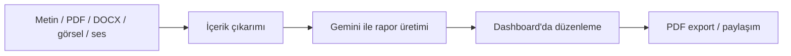

# İSG Saha Asistanı

6331 Sayılı Kanun ve Yapı İşlerinde İSG Yönetmeliği uyumlu, yapay zeka destekli saha denetim ve kurumsal raporlama platformu.

[](https://nextjs.org/)
[](https://www.typescriptlang.org/)
[](https://supabase.com/)
[](https://ai.google.dev/)
[](LICENSE)

İSG Saha Asistanı; şantiye ve işletmelerde saha fotoğraflarını Gemini Vision AI ile analiz eden, 6331 sayılı İSG Kanunu ve mevzuat maddelerine göre uygunsuzlukları tespit edip aksiyon/termin belirleyen ve çift logolu (Firma + OSGB) resmi PDF denetim raporları üreten profesyonel bir SaaS platformudur.

## Öne Çıkanlar

- **AI Vision ile Saha Fotoğrafı Analizi**: Şantiye fotoğraflarından otomatik mevzuat maddesi, tehlike tanımı, risk seviyesi (Yüksek/Orta/Düşük), DÖF aksiyonu ve termin süresi çıkarma.
- **Resmi Standartlarda PDF Raporlama**: Şantiye/işveren bilgileri, hava durumu, firma ve OSGB çift logo desteği, fotoğraflı bulgu kartları ve ıslak imza alanları.
- **Gelişmiş İSG Asistanları**: Toolbox konuşması, 5 Why kaza kök neden analizi, ramak kala bildirimi, acil durum tatbikat senaryosu ve iskele kontrol listeleri.
- **Rapor Paylaşımı**: Güvenli token ve son kullanma tarihli online rapor görüntüleme ve indirme linkleri.
- **Kullanıcıya Özel API Anahtarı**: BYOK (Bring Your Own Key) ile kişisel Gemini API anahtarı desteği.

## Ürün Akışı



## Teknoloji

| Katman | Teknoloji |
| --- | --- |
| Frontend | Next.js App Router, React, TypeScript |
| Arayüz | Tailwind CSS, shadcn/ui, Radix UI, Lucide Icons |
| Backend | Next.js API routes, Server Components |
| Veritabanı/Auth | Supabase Auth, Supabase Postgres |
| AI | Google Gemini (`@google/generative-ai`) |
| Dosya İşleme | `pdf-parse`, `mammoth`, `jspdf` |
| Test/Kalite | Vitest, ESLint |

## Kurulum

Bağımlılıkları yükleyin:

```bash
npm install
```

Ortam değişkenlerini hazırlayın:

```bash
cp .env.example .env.local
```

Windows PowerShell kullanıyorsanız:

```powershell
Copy-Item .env.example .env.local
```

Geliştirme sunucusunu başlatın:

```bash
npm run dev
```

Uygulama varsayılan olarak [http://localhost:3000](http://localhost:3000) adresinde çalışır.

## Ortam Değişkenleri

| Değişken | Zorunlu | Açıklama |
| --- | --- | --- |
| `NEXT_PUBLIC_SUPABASE_URL` | Evet | Supabase proje URL'i |
| `NEXT_PUBLIC_SUPABASE_ANON_KEY` | Evet | Supabase public anon key |
| `GEMINI_API_KEY` | Evet | Varsayılan Google Gemini API anahtarı |
| `USER_API_KEY_ENCRYPTION_KEY` | Evet | Kullanıcı API anahtarlarını şifrelemek için uzun secret |
| `ENABLE_MODEL_DEBUG_ENDPOINT` | Hayır | `/api/test-models` endpoint'ini non-prod ortamda açar |
| `DEBUG_MODEL_ALLOWED_USER_IDS` | Hayır | Debug endpoint erişimi için virgülle ayrılmış kullanıcı ID listesi |

## Komutlar

| Komut | Açıklama |
| --- | --- |
| `npm run dev` | Geliştirme sunucusunu başlatır |
| `npm run dev:reset` | `.next` klasörünü temizleyip dev sunucusunu başlatır |
| `npm run lint` | ESLint kontrollerini çalıştırır |
| `npm run test` | Vitest testlerini çalıştırır |
| `npm run build` | Production build alır |
| `npm run start` | Production sunucusunu başlatır |

## Proje Yapısı

```text
src/
  app/                  Next.js App Router sayfaları ve API endpoint'leri
  components/           Ortak UI ve ürün bileşenleri
  lib/                  Supabase, Gemini, güvenlik ve yardımcı fonksiyonlar
  services/             Rapor üretimi ve iş mantığı servisleri
  types/                TypeScript tipleri
public/
  fonts/                PDF çıktısı için gömülü fontlar
```

## Güvenlik Notları

- `.env.local` dosyasını repoya eklemeyin.
- Kullanıcı Gemini API anahtarları `USER_API_KEY_ENCRYPTION_KEY` ile şifrelenmelidir.
- Supabase tablolarında Row Level Security politikalarını aktif tutun.
- `ENABLE_MODEL_DEBUG_ENDPOINT` değerini production ortamında kapalı bırakın.

## Yol Haritası

- README için gerçek dashboard ekran görüntüleri ve kısa demo GIF'i
- DOCX dışa aktarma
- Kullanıcı tanımlı rapor şablonları
- Ekip/organizasyon çalışma alanları
- Eski raporlar üzerinde semantik arama

## Lisans

Bu proje [MIT lisansı](LICENSE) ile lisanslanmıştır.
